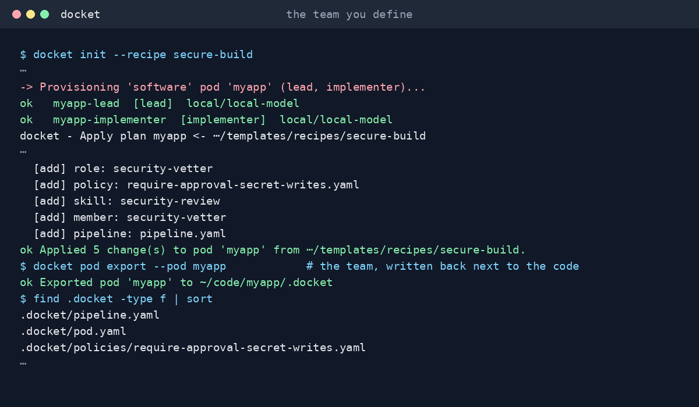

# docket — agent teams as configuration. Your rules, in YAML.

[](https://github.com/yielab/docket/actions/workflows/ci.yml)
[](LICENSE)
[](https://www.python.org/)
[](specs/)

**docket is a command-line tool that puts a team of AI coding agents to work on a git repository,
under rules you write and a gate they cannot skip.**

A pod can also run another kind of team, for research, content or outward work with no repository
behind it, on demand or on a schedule that `docket start --dispatch` fires, under the same gate.

You describe a task in plain words. A Lead agent plans it, an Implementer makes the change on its
own git branch, and, if your team has one, a reviewer checks the result before you
merge anything. Every action an agent takes (reading a file, editing one, running a shell command)
passes one checkpoint that applies your rules: `git status` runs, `git push origin production`
waits for your approval, and anything a policy forbids is refused. Every decision is written to a
tamper-evident log you can verify.

The team itself is a few YAML files in your repository, so changing who does what is editing a
file and committing it. Roles, pipelines and policies combine freely, with no code: a Lead and an
Implementer; the same pair behind a read-only security vetter that can send the change back once
(`secure-build`); a
builder on one provider's model checked by a reviewer on another's (`cross-family-review`). A
pipeline can also route on a step's outcome, skip a step on a condition, run a command, or stop
and ask you. docket works with any model that speaks the OpenAI chat format, and with Anthropic's
Messages API natively, hosted or running on your own machine.

[Website](https://yielab.com/docket) · [Documentation](docs/README.md) ·
[Quick start](docs/QUICK-START-DOCKET.md) · [Recipes](docs/recipes.md) ·
[Security](SECURITY.md) · [Adoption evidence](docs/ADOPTION-EVIDENCE.md) ·
[Changelog](CHANGELOG.md)

> [!WARNING]
> docket is beta software. Core contracts are spec-first and test-backed, but the
> project has not been hardened against large deployments or adversarial public-host workloads.
> Expect breaking changes between beta releases and verify consequential outcomes yourself.

## How it works

<p align="center">
  
</p>

Five ideas cover everything docket does:

- **Pod.** A **pod** is the team of agents attached to one repository or, for work with no
  repository, one working directory: its members, its rules, its task queue and the git worktrees
  its agents work in. `docket init` creates one; inside the repository you never type its name.
- **Role.** What an agent is (Lead, Implementer, Reviewer, or one you define), what it is
  told, and which tools it lacks. A reviewer without a write tool *cannot* write; it is not merely
  asked not to.
- **Pipeline.** The order in which roles work a task and the gate after each step: the exit code of
  your verify command or of an independent verifier you name, a reviewer's `APPROVE` or
  `REQUEST-CHANGES`. Each step closes with a structured handoff (a
  summary, its verdict, the files it changed) that is all the next step reads of it.
- **Policy.** A rule checked on every tool call, by every agent: allow it, ask a human, or deny it.
- **Recipe.** A ready-made team, policy pack or working method you add with one command. A
  library of them ships with docket.

Day to day you use a handful of commands: `init` creates the team, `task add` queues work, `run`
takes the next task through the pipeline, `status` and `inbox` show where things stand and what
needs you, and `task answer` settles whatever a task is waiting on, an approval or a question.

docket is not an agent framework you program and not an interactive pair-programming assistant:
it runs the team your files describe. It works beside the coding assistant you already use: that
assistant helps you in a session, under its own permission prompts; docket takes queued work
through a team, under one set of rules for every member and every step. It has no web UI of its own; `/status.json` and `/metrics`
feed your own board, and docket does not ship one.

Agents work with the tools a role allows: reading, searching and editing files, shell commands
(which can run in the background under a handle the turn stops when it ends), and `fetch`, which
reads a web page as text from hosts you allow and nowhere else. The `web-research` recipe
searches the web through a search server you declare.

## Install

With Homebrew (macOS and Linux):

```bash
brew tap yielab/docket-cli https://github.com/yielab/docket
brew trust yielab/docket-cli            # Homebrew 7 loads a third-party tap only once trusted
brew install docket-cli
```

Or with the installer, which needs no `sudo`: the [quick start](docs/QUICK-START-DOCKET.md#1-install)
gives the command, pinned to a release tag so the script you run cannot change after you read it.

You need Python 3.11+, Git, Bash, and a model endpoint with function tools: one that speaks the
OpenAI chat-completions format, or Anthropic's Messages API. Hosted providers (Anthropic, OpenAI,
Google, OpenRouter, Vercel AI Gateway and others) and local servers (llama.cpp, vLLM, LM Studio,
Ollama) both work. With Anthropic, docket marks the prompt cache, so the part of a turn that
does not change is read from the cache instead of being sent fresh on every call.

## Quick start

**1. Connect a model.** `docket setup` shows what is configured and what is missing, and on a
terminal asks for the model endpoint first. To register a local server in one command:

```bash
docket setup
docket setup provider add local http://127.0.0.1:8081/v1 \
  --model local-model --ctx 32768 --max-tokens 4096
```

**2. Create the team.** Inside your repository:

```bash
cd ~/code/myapp
docket init                               # a Lead that plans + an Implementer that edits
docket init --recipe secure-build         # or: that team plus a read-only security vetter
```

**3. Give it a task and run it.**

```bash
docket task add "Create FIRST_TURN.md containing: governed first turn"
docket run
```

**4. See what happened.**

```bash
docket status                             # the queue, the last run, tokens used, what needs you
docket task trace <id>                    # every step the agents took
docket log verify                         # check the hash chain over every decision
```

The change stays in the Implementer's worktree until you merge it. The
[ten-minute quick start](docs/QUICK-START-DOCKET.md) walks the same path with real output.

## Make the team yours

When the defaults stop fitting, `docket pod export` writes the team into your repository:

```text
.docket/
  pod.yaml                 kind: pod       who is on the team, the pod's settings
  roles/*.yaml             kind: role      what a role may not do, how it is gated, its model
  pipeline.yaml            kind: pipeline  who works a task, in what order, behind which gates
  policies/*.yaml          kind: policy    what always needs a human
  prompts/<layer>/*.md     kind: prompt    the text a hop or an identity is built from, by name
  skills/<name>/           SKILL.md        instructions an agent reads on demand
```

Edit a file, check it with `docket pod validate`, preview the run with `docket pod plan`, and
apply it with `docket pod update .docket`. Commit the directory and a plain `docket init` builds
the same team on any machine. [Configuration](docs/CONFIGURATION.md) covers every file and
setting; the [recipe library](docs/recipes.md) shows what each recipe adds.

**Prompts are versioned configuration.** Every message a hop is sent is built from named prompt
files, and the nearest of four places wins: your repository, the pod, your own configuration,
then the ones docket ships. `docket pod update` records each file it applied, with its SHA-256,
in a lock file, and every hop records the name, version, SHA-256 and source of each prompt it
was built from, so two runs show whether a prompt changed between them. A prompt can carry its
own test cases: `docket pod test <prompt>` runs them against a model, and a role can refuse a
model that failed them.

## See what happened

Every task leaves a trace of each model call and tool call, and every decision goes to the audit
log. `docket task trace <id>` shows one task step by step; `docket log --summary` shows the tokens
per accepted task and how much of the input was read from the model's cache, both measured.

To look at runs in a tracing tool, `docket setup export enable langfuse` (or `otel-collector`,
`jaeger`, `honeycomb`, `phoenix`) sends each run as OpenTelemetry spans: one trace per task, a
span per hop holding its model calls (with tokens and cache reads and writes) and tool calls, and
a span for each pause that waited on a person, with what it asked and what was answered. Nothing
leaves your machine until you enable an exporter, and its privacy level decides what does: the
structure alone by default, up to the full conversation with
`docket setup export privacy <name> full`; `docket setup export preview <name>` shows the exact
payload first.

## Known limits

Read these before trusting docket with anything consequential:

- **One machine, one operator.** No multi-tenancy, hosted scheduler or worker queue.
- **Sandboxing needs a backend.** `docket init` turns it on where the machine has Landlock or
  Seatbelt; without one, or after `docket setup sandbox off`, an agent's shell commands run on your
  machine and can reach the network.
- **The audit log is tamper-evident, not tamper-proof.** Deleting it is visible, not impossible.
- **Costs are estimates.** Token counts are measured; docket records no dollar spend, and its
  budget limit works on a labelled estimate.
- **An exporter shares what you allow.** At `conversation` or `full`, the destination receives
  prompts, replies and tool output, which can include your code.
- **Models vary.** A small local model can give different results run to run; a tool-calling
  endpoint is required for real work.

The full list, with the reasoning behind each limit, is in
[Known limits](docs/README.md#known-limits). Read [SECURITY.md](SECURITY.md) before exposing a
service and [COMPATIBILITY.md](COMPATIBILITY.md) before relying on a model endpoint or MCP server.

## Documentation

| I want to… | Read |
| --- | --- |
| Go from install to a first governed run | [Quick start](docs/QUICK-START-DOCKET.md) |
| Understand roles, pods, pipelines and gates | [Agent teams](docs/AGENT-TEAMS.md) |
| Change any file or setting | [Configuration](docs/CONFIGURATION.md) |
| Write, version and test prompts | [Agent teams](docs/AGENT-TEAMS.md#what-a-hop-is-sent-and-what-it-returns) |
| Send runs to Langfuse or OpenTelemetry | [Export traces](docs/CONFIGURATION.md#314-export-traces-to-opentelemetry-or-langfuse) |
| Pick a ready-made team or method | [Recipe library](docs/recipes.md) |
| Look up a command or flag | [Command reference](docs/commands.md) |
| Connect a hosted or local model | [Models and gateways](docs/MODEL-GATEWAYS.md) |
| Know what the gate enforces | [Security model](docs/SECURITY-SIMPLE.md) |
| Fix a problem | [Troubleshooting](docs/troubleshooting.md) |
| Embed the gate in my own application | [Architecture](docs/DOCKET.md) and [Compatibility](COMPATIBILITY.md) |

The embeddable runtime ships as a separate package, **`docket-runtime`**, built from this
repository's source and not published to any index. Every guide is listed in the
[documentation index](docs/README.md).

## Contributing

docket is built spec-first and test-first. Start with [CONTRIBUTING.md](CONTRIBUTING.md); the
[roadmap](ROADMAP.md) records current plans and decisions, and [specs/](specs/README.md) holds the
executable contracts.

## License

Apache-2.0. See [LICENSE](LICENSE).
