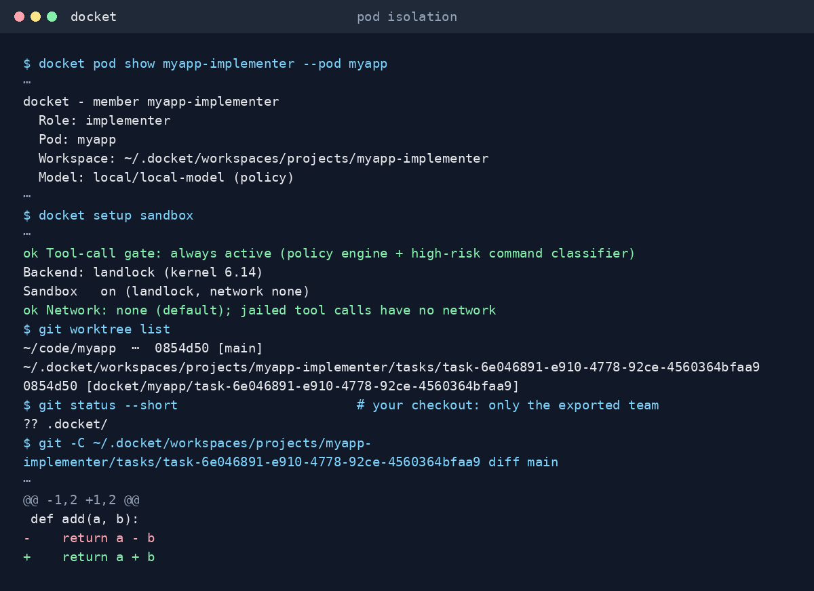

# Agent Teams (Pods) — the heart of docket

> **This is the most important concept in docket.** docket gives a repository a team of coding
> agents and governs what they may do; the team is YAML in `.docket/`. This guide explains the
> roles, pods and gates that YAML describes. If you read one guide, read this one.

A single autonomous agent is easy. Getting several agents to ship real software together is
harder: it needs the same separation of duties a human team has — someone who plans and talks to
people, someone who writes the code, someone who reviews it, someone who tests it — with hard
boundaries so one project's work never contaminates another's. docket makes that structure
first-class.

---

## The two axes: scope and role

Every agent docket manages has two independent properties. Conflating them is the mistake that
makes naive multi-agent setups fall apart.

| Axis | Values | Meaning |
|------|--------|---------|
| **scope** | `project` | Owned by exactly one project; no agent is shared between pods |
| **role** | lead, implementer, reviewer, … | What the agent is *for* |

Every team member lives in a **project pod** — `scope: project`, a self-contained team **per project**, never shared.

The role list above is the everyday roster, not a closed enum — see "Role archetypes" below for
how a role is actually defined and how you add your own.

---

## Project pods — one isolated team per project

`docket init <project>` provisions a **pod**: a small team of project-scoped agents that owns one
codebase (or, for a non-software pod, one shared working directory — see "Pod blueprints" below).
Each member is a distinct registered agent with its **own permission-locked workspace**
(`700`/`600`, with `SOUL.md`, `AGENTS.md`, `HEARTBEAT.md`, `.docket-meta.json`, and a `memory/`
log) — so **no role is ever shared between two projects.**

The default pod is **lean — a Lead and an Implementer.** You add a Reviewer, or extra
Implementers when the work warrants it.

<p align="center">
  
</p>

| Pod role | Edits code? | Responsibility | Default model class |
|----------|:-----------:|----------------|---------------------|
| **Lead** | **never** | Orchestrates the pod, owns its context and memory, decomposes work, dispatches to workers; surfaces architectural decisions and risky actions at the top of the plan with assumptions and open questions listed | cheap (coordination) |
| **Implementer** | **yes** | Runs *inside* the project workspace and writes the code | strong (reasoning-dense) |
| **Reviewer** *(optional)* | no (read-only) | Veto on the work of the step before — correctness + security gate | strong |

Member ids are predictable: `myapp-lead`, `myapp-implementer`, `myapp-implementer-2`,
`myapp-reviewer`. Because each is an ordinary registered agent,
`docket status --all` and `docket setup` cover every pod member for free.

```bash
docket init myapp ~/code/myapp       # lean pod: myapp-lead + myapp-implementer
docket init myapp ~/code/myapp --pod full        # full pod: + reviewer
docket init myapp ~/code/myapp --with reviewer   # lean pod + a reviewer
cd ~/code/myapp && docket init       # same lean pod, id/path/stack derived from the cwd;
                                     # a committed .docket/ is validated and applied
docket init --recipe secure-build    # lean pod + a shipped recipe (or a directory of your own)
docket pod show                      # inspect the pod and its roles
docket pod add reviewer              # add a role to an existing pod (never creates one)
docket pod add implementer           # scale out: adds another implementer
docket pod add reviewer              # add a role later
docket pod remove <member-id>        # drop a member
docket pod delete                    # tear down the whole pod
```

A pod has **exactly one Lead** (its single orchestrator); every other role may be duplicated.

---

## Role archetypes — roles are data, not hardcoded branches

A pod role is not a closed set wired into code, and adding a fifth role needs no code change.
Every role — including the four built-in ones — is a **role archetype**
(`teams/roles.py`): a versioned, declarative record of its scope, model class, identity
templates, gate contract, denied tools, and tool profile.

```bash
docket pod roles                 # every registered archetype: built-in, starter, user
docket pod roles reviewer        # one archetype's full definition (YAML/JSON)
docket pod update ./producer.yaml  # register a custom archetype from a YAML file
docket pod validate ./producer.yaml   # dry-run the schema + template render
```

Three **built-in** archetypes cover the everyday roster. A **starter library**
ships six more you can drop into any pod without writing a line of YAML:

| Name | Class | Gate | Denied tools |
|---|---|---|---|
| `lead` *(built-in)* | cheap | none | write, edit, bash |
| `implementer` *(built-in)* | strong | mechanical (`verifyCmd`) | none |
| `reviewer` *(built-in)* | strong | verdict (APPROVE / REQUEST-CHANGES) | write, edit, bash |
| `researcher`, `analyst` *(starter)* | strong | none | none |
| `writer` *(starter)* | cheap | none | none |
| `operator` *(starter)* | strong | mechanical | none |
| `monitor` *(starter)* | cheap | approval | write, edit, bash |
| `actor` *(starter)* | strong | none | write, edit, bash (reads with `read`, `glob` only) |

Provisioning a starter role into a live pod works exactly like any other role:
`docket pod add researcher`. A user-authored archetype (a standalone YAML file,
`docket pod update`) can add a brand-new role name or override an existing one — merged into the
pod's own `config/pods/<pod>/roles/` files, the pod wins by name. A denied tool is absent from that role's turn,
not merely discouraged: it is the only capability statement a role carries (`cannot:` in the short
form). Denying a built-in tool removes that tool alone; denying one also removes every MCP tool of
its kind.

A custom role's hop message is also data: an archetype can declare its own `hopInstruction` text;
if it doesn't, one is generated from its `gateContract` (a verdict role, for example, is told its
exact `APPROVE`/`REJECT`-style marker convention). Either way, a pipeline step's own `instructions`
(when set) overrides it for that one hop — see [Pipelines](WORKFLOW-GUIDE.md#pipelines-the-one-dialect)
in the Workflow Guide.

Composing several starter roles into one pod shape, in a single command, is a **pod blueprint** —
next section.

---

## Pod blueprints — named pod shapes

`docket init` doesn't have to produce a Lead+Implementer pod against a codebase. A **pod blueprint**
(`teams/blueprints.py`) is a named, versioned pod shape: a roster of archetypes, a default
pipeline, a workspace kind, and an optional default budget cap — provisioned in one command.

```bash
docket init my-market-scan --blueprint respond
# Provisioning 'respond' pod 'my-market-scan' (lead, researcher, writer, reviewer, actor)...
```

Four blueprints exist, one per pipeline shape behind every department:

| Blueprint | Workspace kind | Roster | Default budget | Pipeline |
|---|---|---|---|---|
| `build` *(default)* | codebase | lead, implementer, reviewer | (none) | lead -> implementer (mechanical) -> reviewer (verdict, rework -> implementer) |
| `respond` | workdir | lead, researcher, writer, reviewer, actor | $20 | intake -> research -> draft -> review (verdict, rework -> draft) -> act |
| `operate` | workdir | lead, monitor, operator, reviewer | $30 | watch -> propose (approval) -> act (mechanical) -> review (verdict) |
| `routine` | workdir | lead, analyst, writer, reviewer | $15 | compile -> draft -> review (verdict, rework -> draft) |

Omitting `--blueprint` (or passing `--blueprint build` explicitly) is exactly a plain
`docket init` — the lean Lead + Implementer pod, same files, no behavior change; the `build` roster
carries the Reviewer so the pipeline's review step reaches a hop once you widen the pod
(`--pod full`). `respond`, `operate` and `routine` are **`workdir`-kind**: no codebase is assumed or
auto-detected; the pod gets a shared working directory instead (auto-provisioned if you don't name
one). `--pod full`/`--with` only apply to the `build` roster — passing them against another blueprint
warns and provisions that blueprint's own fixed roster instead of trying to combine the two.

A department is a shape plus your own prose, connectors and policy, not another blueprint. A
`respond` pod needs the operator's role overlay to name the Actor's send tool; the `outward` recipe is
the policy pack that asks before every send and caps them.

Start lean and grow only when the work earns it:

| Situation | Pod |
|-----------|-----|
| Prototyping, low-risk changes, solo project | **lean** (Lead + Implementer) — the default |
| Code that needs a correctness/security gate before it lands | add a **Reviewer** (`--with reviewer`) |
| High-stakes or high-blast-radius work | **full** pod (`--pod full`) |
| One Implementer is the bottleneck | `docket pod add implementer` (parallel doers) |
| Non-software work (research, writing, ops) | pick a **blueprint** (`--blueprint respond`) instead of building roles up by hand |

The Reviewer is the difference between "an agent changed the code" and "a change was
reviewed before it landed" — the line between a prototype and a change you can let
into a real codebase.

---

## Session keys & isolation

Pod members share the project's session-key namespace (`agent:<project>:<key>`), which keeps the
pod's conversation context together and **isolated from every other project**. Dispatch runs each
task on its own per-task session (`agent:<project>:<task_id>`) so tasks don't bleed into each
other. The real isolation
primitive, though, is the **per-member workspace** — session keys isolate conversation; separate
workspaces isolate files, memory, and identity.

---

## Per-role model policy

Each role maps to the **cheapest model adequate for its workload** — coordination and
review/test are cheap-class; the Implementer (and security audits) get the strong class. Change a
role once and every policy-following agent re-resolves; override per-pod with a role overlay or set per step (`model:` in the pipeline). A
starter or custom archetype with no dedicated policy-table row falls back to resolving through its
own `modelClass` (`cheap`/`strong`) instead of the global default — see `docket pod roles <name>`
for what class a given role carries.

| Role | Default class |
|------|---------------|
| Lead | cheap |
| Implementer | strong |
| Reviewer | strong |

See [Architecture (DOCKET)](DOCKET.md) for the routing internals and
[Command Reference](commands.md) for every flag.

---

## Command reference (teams)

```bash
# Provision / resize a pod
docket init                               # lean pod for the cwd (id, path, stack derived from it)
docket init <project> [path]              # lean pod (Lead + Implementer)
docket init <project> [path] --pod full   # + Reviewer
docket init <project> [path] --with reviewer
docket init <project> [path] --blueprint <name>   # build (default) | respond | operate | routine
docket pod recipes                      # the seventeen shipped recipes and your own, what each brings
docket init --recipe <name|dir>          # + a recipe (a team, a policy pack, a methodology) or
                                         #   your own directory; a committed .docket/ is applied
                                         #   by plain `docket init`
docket pod update <name|dir>    # apply a recipe name or a directory such as .docket
docket pod export [<dir>]      # write the pod's own scope back to .docket/
docket pod validate [<dir|file>]       # check every kind: document before applying
docket pod show                         # list members
docket pod add <role> [--count N]
docket pod add <role> [--pod <name>] [--count N]  # same, from outside the repo
docket pod remove <member-id>
docket pod delete                      # tear down the whole pod

# Role archetypes
docket pod roles                        # every registered archetype
docket pod roles <name>                 # one archetype's full definition
docket pod update <file.yaml>             # register/override a custom archetype
docket pod validate [file.yaml]        # dry-run schema + template validation

# Run the pipeline
docket task add [--priority high|normal|low] [--brief FILE.json] "<task>"
docket task list
docket run
docket pod add implementer --verify "<cmd>"   # Implementer's mechanical gate
docket pod set verify "<cmd>" --member <member-id>
docket start --dispatch                  # autonomous: drive every pod's queue

# The operator loop: what needs you, and answering it
docket inbox [--json] [--since <iso>] [--peek]           # everything across every pod that needs you
docket task answer <task-id> [--pod <project>]                  # see + answer one task's parked question
docket task answer <task-id> [text]                   # answer, non-interactively
docket task pregrant <task-id> "<command>"             # pre-approve one exact call
docket setup notify list                                # who gets notified, and how much they see
docket setup notify flush                               # push pending notifications now

```

> Every project's pod owns its own task queue and runs (see above). There is no org-wide
> queue.
